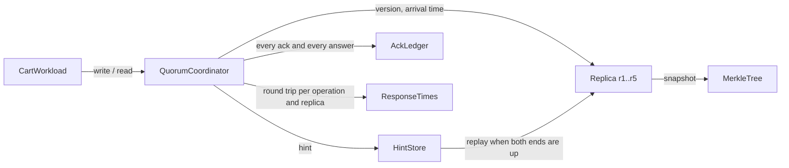

# Architecture of seatwave-quorums

A deterministic model of SeatWave's leaderless cart store: five replicas, tunable R and W, hinted handoff, read repair and Merkle-tree anti-entropy, on a virtual clock. It needs only the JDK; the libraries in the build are for the tests and the formatter.

## Packages

One package, `io.plainround.seatwave.quorums`. Every type is package-private except the two that other code may name: `ResponseTimes` and the four `*Cli` programs.

| Type | Role |
|---|---|
| `QuorumSettings` | N, R, W as a record; `overlaps()` is R + W > N |
| `Version` | key, value, one write sequence; the highest sequence wins (last writer wins). Module 25 replaces the sequence with vector clocks |
| `Replica` | one node: the versions it received, each visible from its arrival; outages; a message that arrives while it is down is lost |
| `HintStore` | hints held by stand-ins `s1` and `s2` for home replicas that were down; replay needs both ends up; hints can be lost |
| `ResponseTimes` | seeded round trips (98 percent 2 to 8 ms, 2 percent 8 to 32 ms); same luck for every R and W |
| `QuorumCoordinator` | the only way in: writes to all up homes and waits for W, reads from all and answers after R; `WritePolicy` and `ReadRepair` |
| `AckLedger` | the record of truth: stale and backwards reads, and the check that stops the run if a read breaks R + W > N after a strict acknowledgement |
| `MerkleTree` | hash tree over a replica's newest versions; leaves are token ranges; `compareWith` descends only where hashes differ |
| `CartWorkload` | SeatWave cart traffic on the virtual clock: adds, re-reads, background reads, hint replay |
| `QuorumSweepCli`, `ReplicaHealingCli`, `SloppyQuorumCli`, `QuorumAnomaliesCli` | the only code that prints |

Dependency rule: `*Cli` -> `CartWorkload` -> `QuorumCoordinator` -> (`Replica`, `HintStore`, `AckLedger`, `ResponseTimes`, `QuorumSettings`, `Version`); `ReplicaHealingCli` also uses `MerkleTree`. Nothing below a `*Cli` prints or exits.

## Data flow

## Walk-throughs

A write: the coordinator sends the version to every home replica it believes is up; each replica that is still up on arrival stores it and its acknowledgement arrives one round trip later; the acknowledgements are sorted and the client hears "added" at the W-th. If fewer than W arrive the client is told "refused" but the version stays where it landed (a partial write). Under `STRICT_WITH_HINTS` and `SLOPPY_WITH_HINTS` a stand-in keeps a hint for each missed home replica; only sloppy counts the stand-in's acknowledgement toward W.

A read: the coordinator asks all N, sorts the replies by arrival, takes the first R and answers with the newest version among them (not the fastest). `ReadRepair.ON` then sends the newest version of all replies to every replica that replied older; `BLOCKING` repairs the older ones among the first R before answering and waits for their acknowledgements, so two successive reads cannot go backwards.

## Decisions and trade-offs

- A virtual clock, not threads: runs are repeatable byte for byte, which is what lets the module print real numbers. The cost: no real contention, no real network; every latency is the model's assumption.
- One write sequence per coordinator: simple last-writer-wins. Concurrent writes from two coordinators are not modeled (Module 25).
- Replicas keep data across an outage (the disk is intact); only messages sent while down are lost.
- Asynchronous repair is `ON` and blocking repair is `BLOCKING`; the four programs report `OFF` and `ON`, so their output is unchanged by `BLOCKING`.

## Invariants and where they are enforced

| Invariant | Enforced by | Tested by |
|---|---|---|
| With R + W > N and strict quorums, a read never returns older than an acknowledged write | `AckLedger.recordRead` throws `IllegalStateException` | `QuorumOverlapTest`, `AckLedgerTest` |
| A read answers with the newest of the R replies, not the fastest | `QuorumCoordinator.read` | `QuorumCoordinatorTest` |
| A write is acknowledged only with W acknowledgements, at the W-th | `QuorumCoordinator.write` | `QuorumCoordinatorTest` |
| A hint is replayed only when stand-in and home replica are both up | `HintStore.replay` | `HintStoreTest` |
| A Merkle root does not depend on insertion order; leaf count is a power of two of at least 2 | `MerkleTree.build` | `MerkleTreeTest` |
| A message that reaches a down replica is lost | `Replica.receive` | `ReplicaTest` |
| An invalid value cannot exist (sequence below 1, R or W outside 1 to N, outage that ends before it starts) | compact constructors | `VersionAndResponseTimesTest`, `QuorumSettingsTest`, `ReplicaTest` |
